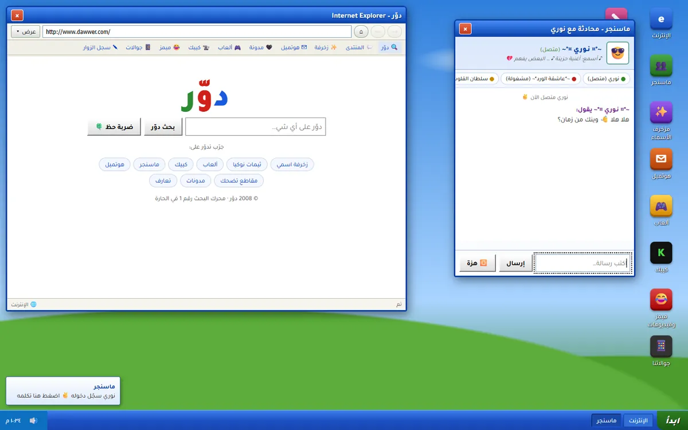
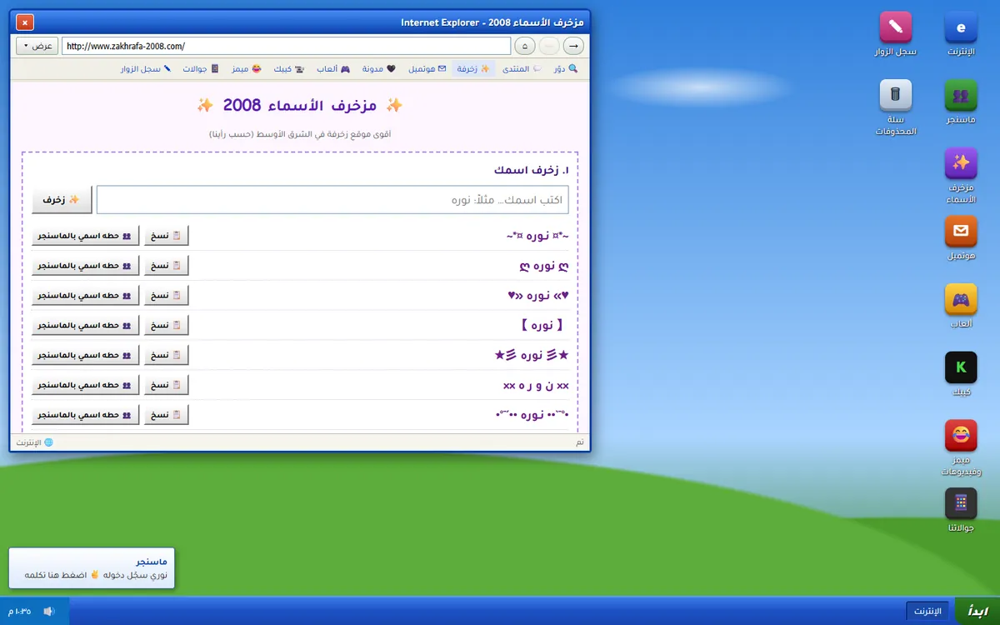
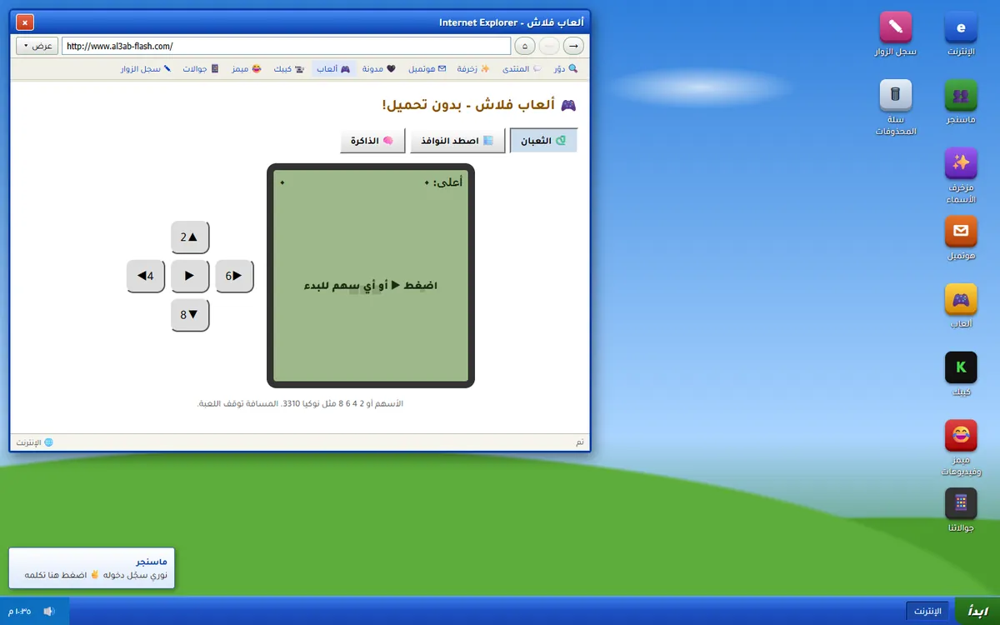
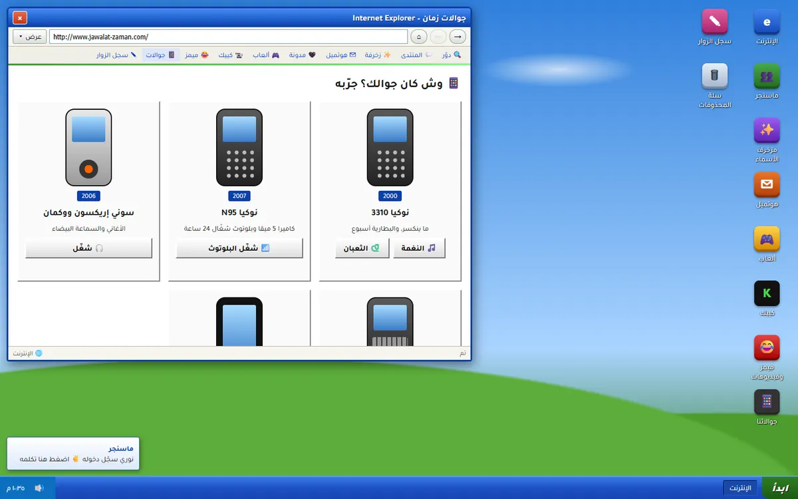

# Internet 2008 (إنترنتنا القديم 2008)

A personal project I made for fun: the Arabic internet we grew up with, as a website you can dial into.

مشروع شخصي سوّيته للمتعة: الإنترنت العربي اللي كبرنا معه، كموقع تتصل فيه وتعيش 2008 من جديد.

**Try it:** [hailahalhejjei.github.io/internet-2008](https://hailahalhejjei.github.io/internet-2008/) (turn the sound on; it works best on a computer)

## What's inside

- **Dial-up:** connect on a 56k modem, sound included.
- **A desktop from 2008:** Internet Explorer, Messenger, a media player, a Start menu and a recycle bin.
- **Made-up Arabic sites:** Dawwer search, a memories forum, Hotmail, a blog you have to fix the text encoding to read, a download page, a blocked site, Keek, memes and videos, and old phones.
- **Messenger:** chat with Nouri, and send (or get) a nudge.
- **Name decorator:** turn your name into 2008 style decorated text.
- **Flash games:** Snake, catch the pop-ups, and a memory game.
- **Bluetooth:** send a file to a friend's phone, and hope it gets past 99%.
- **Guestbook:** sign it, and get a reply from 2008.
- **Shut down:** see a summary of your session before you leave.

| | | |
|---|---|---|
|  |  |  |

## Built with

- HTML, CSS and JavaScript in one file
- Web Audio API: the modem and system sounds are made in code
- Google Apps Script for the guestbook

Made by Hailah Alhejjei · [portfolio](https://hailahalhejjei.github.io)
